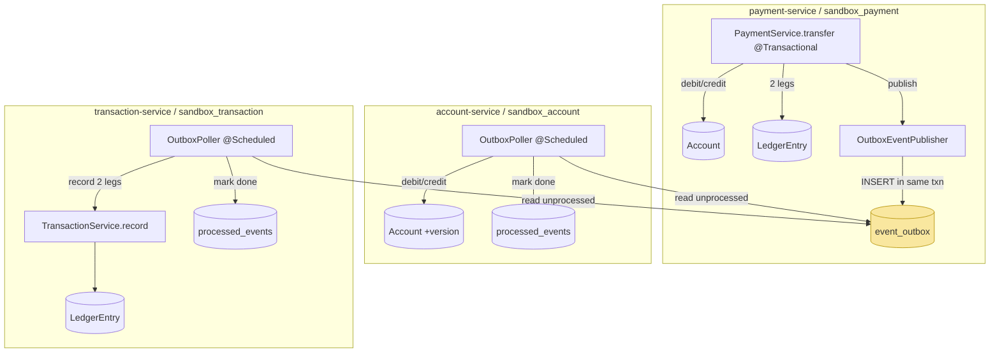
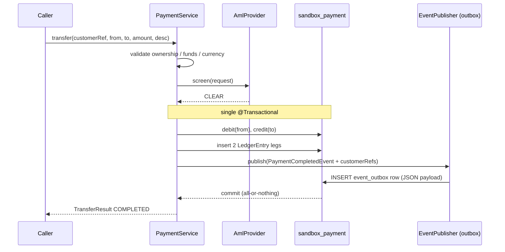
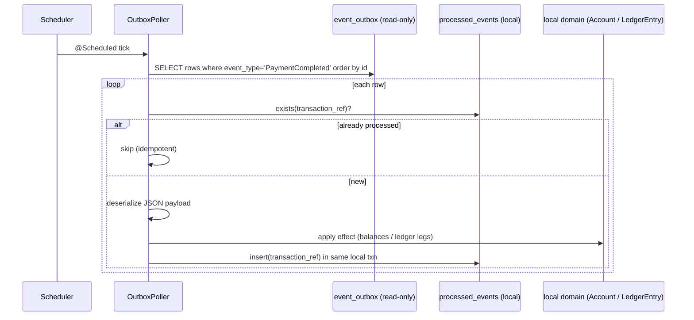
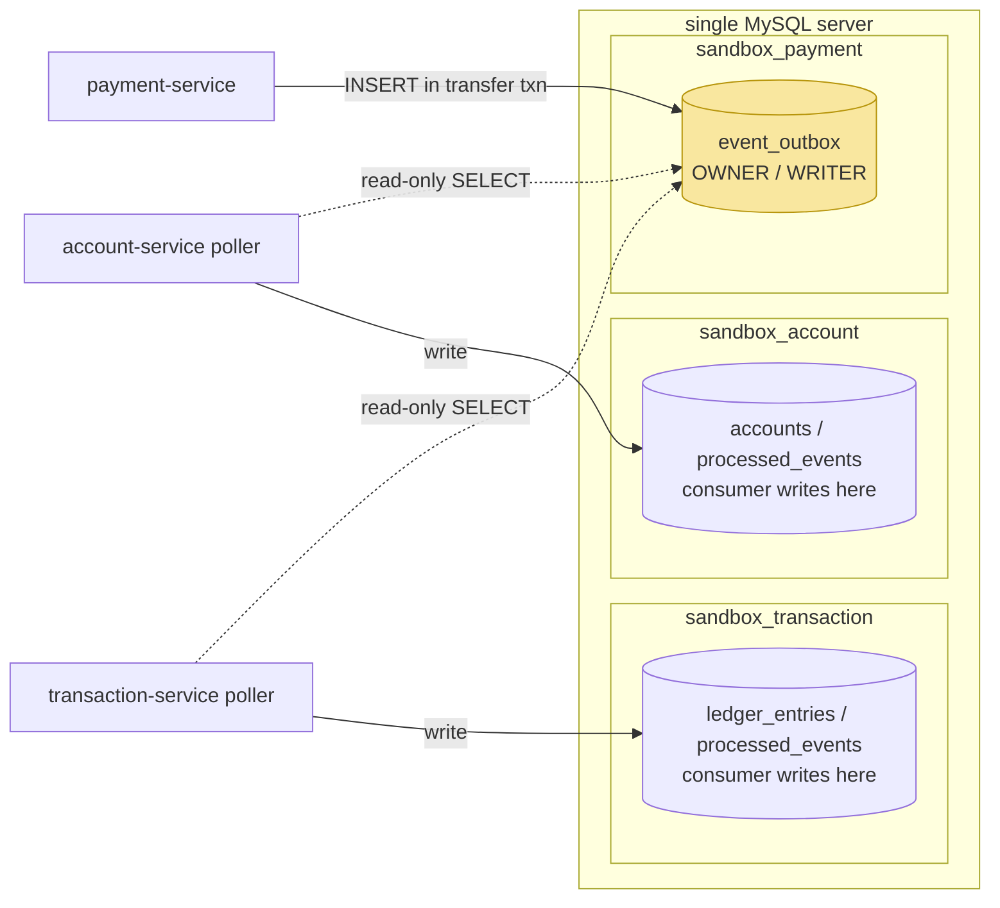

# Design Document: Outbox Balance & History Propagation

## Overview

A completed transfer in the RP Digital Bank Sandbox currently mutates state only inside `payment-service`'s own schema (`sandbox_payment`). It debits/credits payment-service's `Account` entities, writes two balanced `LedgerEntry` legs, then publishes a `PaymentCompletedEvent` through the pluggable `EventPublisher`. The only publisher implementation is `InProcessEventPublisher` (a thin wrapper over Spring's `ApplicationEventPublisher`), which is in-JVM only. No component in `account-service` or `transaction-service` listens for that event, so their state never changes: account-service balances drift out of sync and transaction-service statement history stays empty.

This feature propagates a completed transfer to the other two services using the **Transactional Outbox** pattern plus `@Scheduled` pollers, reusing the existing `EventPublisher` seam. Because all services share one MySQL instance with separate logical schemas, payment-service writes a row into a shared `event_outbox` table **inside the same transaction as the transfer** (atomic — no event without money movement, no money movement without an event). `account-service` and `transaction-service` each run an independent poller that reads unprocessed rows, applies its own local effect (balance update / ledger append), and records the `transaction_ref` in a per-service `processed_events` table for idempotency. A new `OutboxEventPublisher` sits behind `provider.events=outbox` while `in-process` remains the default, so the transport can later be swapped for Kafka without touching business code.

No new infrastructure is introduced (no Kafka/Redis/RabbitMQ, no inter-service HTTP). Per-service DB isolation is preserved: the outbox table is written only by payment-service and read-only polled by the two consumers; all data a consumer needs travels inside the event payload.

## Architecture



Key architectural points:

- `event_outbox` lives in payment-service's schema and is owned (write) by payment-service. Consumers only `SELECT` from it; they never write business tables of another service.
- Each consumer is fully independent: separate poll loop, separate `processed_events` table, separate failure domain. One consumer lagging or failing does not affect the other or the producer.
- The outbox write is bound to the transfer transaction, so a rolled-back transfer (e.g. AML block, insufficient funds) leaves no outbox row.

### Transfer + outbox write (producer flow)



### Consumer poll flow (account-service and transaction-service)



## Components and Interfaces

### Component 1: `OutboxEventPublisher` (payment-service or events-adapters)

**Purpose**: An `EventPublisher` implementation that serializes a `DomainEvent` to JSON and inserts it into `event_outbox`. Active only when `provider.events=outbox`.

**Interface** (implements the existing seam):

```java
public interface EventPublisher {        // existing, unchanged
    void publish(DomainEvent event);
}

public class OutboxEventPublisher implements EventPublisher {
    public OutboxEventPublisher(OutboxRepository outbox, ObjectMapper mapper) { ... }

    @Override
    public void publish(DomainEvent event);   // serialize + insert one outbox row
}
```

**Responsibilities**:
- Serialize the event payload to a JSON string (portable TEXT column, not native JSON).
- Insert exactly one `event_outbox` row, participating in the caller's active transaction (no new transaction, no `REQUIRES_NEW`).
- Set `event_type = event.eventType()`, `transaction_ref` from the event, `occurred_at = event.occurredAt()`.

### Component 2: `EventsAutoConfiguration` (events-adapters) — extended

**Purpose**: Wire the correct publisher based on `provider.events`. In-process stays the default.

```java
@Bean
@ConditionalOnProperty(name = "provider.events", havingValue = "in-process", matchIfMissing = true)
EventPublisher inProcessEventPublisher(ApplicationEventPublisher delegate);

@Bean
@ConditionalOnProperty(name = "provider.events", havingValue = "outbox")
EventPublisher outboxEventPublisher(OutboxRepository outbox, ObjectMapper mapper);
```

**Responsibilities**: Select exactly one publisher. `matchIfMissing=true` on in-process preserves existing default behavior; adding the `outbox` branch is additive and breaks nothing.

### Component 3: `OutboxPoller` (account-service) 

**Purpose**: Periodically read unprocessed `PaymentCompleted` outbox rows and apply balance changes idempotently.

```java
@Component
class AccountOutboxPoller {
    @Scheduled(fixedDelayString = "${outbox.poll-delay-ms:1000}")
    void poll();   // read -> for each: if not processed, apply debit/credit, mark processed
}
```

**Responsibilities**:
- Read `event_outbox` rows of type `PaymentCompleted` ordered by `id`.
- For each unseen `transaction_ref`: debit `fromAccount`, credit `toAccount` when they exist in `sandbox_account`; record `transaction_ref` in `processed_events`.
- Unknown accounts (not present in this schema): mark processed, no error.
- Requires `@EnableScheduling` on the account-service application class (not currently present).

### Component 4: `OutboxPoller` (transaction-service)

**Purpose**: Periodically read unprocessed `PaymentCompleted` outbox rows and append statement history idempotently.

```java
@Component
class TransactionOutboxPoller {
    @Scheduled(fixedDelayString = "${outbox.poll-delay-ms:1000}")
    void poll();   // read -> if not processed, record 2 ledger legs, mark processed
}
```

**Responsibilities**:
- For each unseen `transaction_ref`, call the existing `TransactionService.record(List<LedgerEntry>)` with a DEBIT leg (source) and a CREDIT leg (destination).
- Populate each leg with `transactionRef`, `customerRef` (from the extended payload — required NOT NULL), `description`, `counterparty`, `amount`, `currency`, `bookedAt = occurredAt`.
- Record `transaction_ref` in `processed_events`.
- Requires `@EnableScheduling` on the transaction-service application class.

## Data Models

### Model 1: `PaymentCompletedEvent` (common) — extended

The current record carries only account numbers. transaction-service's ledger requires a non-null `customer_ref` on every row, and history is queried by `customerRef`. So the payload is extended with both customer refs, populated in `PaymentService` from the `Account` entities it already loads (no cross-schema read).

```java
public record PaymentCompletedEvent(
        String transactionRef,
        String fromAccount,
        String toAccount,
        String fromCustomerRef,   // NEW
        String toCustomerRef,     // NEW
        BigDecimal amount,
        String currency,
        Instant occurredAt
) implements DomainEvent {
    @Override public String eventType() { return "PaymentCompleted"; }
}
```

**Validation / rules**:
- `fromCustomerRef` / `toCustomerRef` are non-null (sourced from loaded accounts).
- Adding fields to the record is safe: the only existing consumer is the in-process path, which is updated in the same change; there are no external consumers.

### Model 2: `event_outbox` (payment-service schema)

```java
@Entity
@Table(name = "event_outbox")
class OutboxEvent {
    @Id @GeneratedValue(strategy = IDENTITY) Long id;
    @Column(name = "event_type", nullable = false)      String eventType;
    @Column(name = "transaction_ref", nullable = false) String transactionRef;
    @Lob @Column(name = "payload", nullable = false)    String payload;     // JSON-as-TEXT
    @Column(name = "occurred_at", nullable = false)     Instant occurredAt;
    @Column(name = "created_at", nullable = false)      Instant createdAt;
}
```

**Validation / rules**:
- `payload` is a portable `TEXT`/`LONGTEXT` JSON string (entity maps to `String`), **not** a native JSON type — H2 MySQL-mode + Flyway + `ddl-auto=validate` make native JSON unreliable; TEXT works identically on H2 and MySQL 8.
- Written only by payment-service; read-only for consumers.

### Model 3: `processed_events` (per consumer: account-service and transaction-service)

```java
@Entity
@Table(name = "processed_events")
class ProcessedEvent {
    @Id @Column(name = "transaction_ref") String transactionRef;   // natural PK = idempotency key
    @Column(name = "processed_at", nullable = false) Instant processedAt;
}
```

**Validation / rules**:
- `transactionRef` is the primary key; a duplicate insert is the idempotency guard. One such table exists independently in each consumer schema.

### Model 4: `account-service` `Account` — add `@Version`

account-service's `Account` currently has no version column/field. Add optimistic locking mirroring payment-service's `Account`, so the poller's debit/credit write path is safe under concurrency.

```java
@Entity
class Account {
    // existing fields: id, accountNumber, customerRef, currency, balance ...
    @Version
    @Column(name = "version", nullable = false)
    Long version;              // NEW

    void debit(BigDecimal amount) { this.balance = this.balance.subtract(amount); }  // NEW
    void credit(BigDecimal amount) { this.balance = this.balance.add(amount); }      // NEW
}
```

## Migrations (Flyway DDL)

Flyway numbering is per-service. account-service and transaction-service have `V1`/`V2`; new migrations are additive.

### payment-service — `V3__create_event_outbox.sql`

```sql
CREATE TABLE event_outbox (
    id              BIGINT        NOT NULL AUTO_INCREMENT,
    event_type      VARCHAR(100)  NOT NULL,
    transaction_ref VARCHAR(100)  NOT NULL,
    payload         LONGTEXT      NOT NULL,   -- JSON serialized as text (portable H2/MySQL)
    occurred_at     TIMESTAMP     NOT NULL,
    created_at      TIMESTAMP     NOT NULL,
    PRIMARY KEY (id)
);
CREATE INDEX idx_event_outbox_type ON event_outbox (event_type, id);
```

### account-service — `V3__add_account_version.sql`

```sql
ALTER TABLE accounts ADD COLUMN version BIGINT NOT NULL DEFAULT 0;
```

### account-service — `V4__create_processed_events.sql`

```sql
CREATE TABLE processed_events (
    transaction_ref VARCHAR(100) NOT NULL,
    processed_at    TIMESTAMP    NOT NULL,
    PRIMARY KEY (transaction_ref)
);
```

### transaction-service — `V3__create_processed_events.sql`

```sql
CREATE TABLE processed_events (
    transaction_ref VARCHAR(100) NOT NULL,
    processed_at    TIMESTAMP    NOT NULL,
    PRIMARY KEY (transaction_ref)
);
```

> Note: with `ddl-auto=validate`, the JPA entities above must match these column definitions exactly (types, nullability, names).

## Addendum: Shared Outbox Location Across Databases (Option A)

> This section documents a **follow-up fix** applied after the initial implementation. It supersedes the earlier assumption that each consumer could own a local `event_outbox` table. The surrounding design (atomicity, idempotency, per-service write isolation) is unchanged — only the **location the consumers read from** is corrected.

### The problem: separate databases, empty local copies

Every service shares one MySQL **server**, but each connects to its **own logical database (schema)** per `docker-compose.yml` `DB_NAME`:

| Service | Database (schema) |
| --- | --- |
| payment-service | `sandbox_payment` |
| account-service | `sandbox_account` |
| transaction-service | `sandbox_transaction` |

The shared `event_outbox` is created and written **only by payment-service** in `sandbox_payment` (see `V3__create_event_outbox.sql`). The initial implementation mistakenly gave each consumer its **own local copy** of `event_outbox`:

- account-service `V5__create_event_outbox_readonly.sql`
- transaction-service `V4__create_event_outbox_readonly.sql`

Those copies lived in `sandbox_account` / `sandbox_transaction` and were **never written to** — payment-service only ever inserts into `sandbox_payment.event_outbox`. So each consumer's poller scanned an **empty local table**, and balances/history never propagated when running against real MySQL.

**Why H2 tests missed it:** each service's integration tests used its **own in-memory H2 database**, seeded directly with outbox rows. There was effectively a single DB per test context, so "the outbox the test seeds" and "the outbox the poller reads" were the same table. The cross-database topology that exists under docker-compose was never exercised, so the empty-copy bug was invisible on H2.

### The Option A solution (user-approved)

payment-service remains the **sole owner and writer** of `event_outbox` in `sandbox_payment`. The two consumers perform a **read-only, cross-database `SELECT`** against `sandbox_payment.event_outbox`, qualified by a **configurable schema name**. No consumer keeps a copy of the table.



- **Writes:** only `sandbox_payment` owns and mutates `event_outbox`.
- **Reads:** consumers issue a qualified `SELECT` (`<outbox.schema>.event_outbox`) — nothing else crosses a database boundary.

### The `outbox.schema` configuration property

A new config property controls which schema the consumer's read-only outbox entity/query targets:

```yaml
# account-service / transaction-service application.yml (compose / production)
outbox:
  schema: sandbox_payment      # read the shared, payment-owned outbox
  poll-delay-ms: 1000
```

The consumer's **read-only** `OutboxEvent` entity resolves its table from this property rather than hard-coding a bare table name. Because JPA `@Table(schema=...)` is a compile-time constant, the schema is bound at runtime via a Hibernate physical-naming / entity-schema resolution hook driven by `${outbox.schema}` (equivalently, a repository `@Query` that references the configured schema). Conceptually:

```java
// consumer side — READ ONLY
@Entity
@Immutable                                   // never updated/inserted by consumers
@Table(name = "event_outbox")                // schema injected from outbox.schema at runtime
class OutboxEvent { /* same columns as producer, all read-only */ }
```

- **Compose / production:** `outbox.schema=sandbox_payment` → consumers read `sandbox_payment.event_outbox`.
- **H2 tests:** the property is **overridden to the single in-memory test database** (e.g. `outbox.schema=` empty / the test schema name), so the entity points at the same DB the test seeds. No cross-database copy table is needed and the existing H2 tests continue to pass unchanged.

### Implementation implications

- **Remove** the per-consumer copy migrations:
  - delete account-service `V5__create_event_outbox_readonly.sql`
  - delete transaction-service `V4__create_event_outbox_readonly.sql`
- **`ddl-auto=validate` must stay satisfied.** The shared `event_outbox` is **not** part of each consumer's own Flyway-managed schema, so Hibernate must not try to validate it against `sandbox_account` / `sandbox_transaction`. The read-only `OutboxEvent` is mapped to target the **configured outbox schema** (`outbox.schema`), so validation resolves against `sandbox_payment` (which really has the table). In H2 tests the entity points at the single test DB, where the table is seeded, so validation also succeeds there. The consumer's **own** Flyway migrations continue to manage only its local tables (`accounts`/`ledger_entries`/`processed_events`).
- **Keep `OutboxEvent` `@Immutable`/read-only on the consumer side** — consumers must never insert/update/delete outbox rows; the annotation makes accidental writes a mapping error.
- **Atomicity is unaffected:** payment-service still writes the outbox row in its **own** database (`sandbox_payment`) inside the transfer `@Transactional`.
- **Per-service write isolation preserved:** consumers still write only their own database (`accounts` / `ledger_entries` / `processed_events`). The **only** cross-database access is the read-only `SELECT` on the shared `event_outbox`.

### MySQL cross-database SELECT prerequisites

- Cross-database `SELECT` works because all three schemas live on the **same MySQL server** — MySQL resolves `schema.table` within one connection. This would **not** work if the databases were on separate servers (that would require a real message transport).
- The consumer's DB user must hold `SELECT` grants on `sandbox_payment.event_outbox`. In the sandbox the services connect as `root`, which already has the necessary privileges; a hardened deployment would grant read-only `SELECT` on that one table explicitly.

### Testing strategy update

- Consumer poller tests (account-service, transaction-service) set `outbox.schema` to the **test DB** and seed `event_outbox` **there**, so the poller reads the rows the test inserted — reproducing the real read path without a cross-database copy table.
- A regression guard: assert that the consumer services define **no** local `event_outbox` migration (the copy migrations are gone) and that the poller reads from the configured `outbox.schema`.

## Addendum: Ledger `transaction_ref` column width

> Follow-up fix found during `docker compose` end-to-end testing against real MySQL.

A real transfer reference is `TXN-<uuid>` = 40 characters. transaction-service's pre-existing `V1__create_ledger.sql` declared `ledger_entries.transaction_ref VARCHAR(36)`, so the ledger insert was rejected with `Data truncation: Data too long for column 'transaction_ref' at row 1` (SQL 1406 / 22001) and the poller retried the row forever (never marking it processed). Net effect: balances propagated but statement history stayed empty. H2 tests missed it because they used short refs (e.g. `TXN-TEST-1`) that fit in `VARCHAR(36)`.

The ledger `transaction_ref` must accommodate `TXN-` + UUID (40 chars); it is widened to `VARCHAR(50)` (consistent with payment-service's ledger) via a new Flyway migration `transaction-service/V4__widen_ledger_transaction_ref.sql` (`ALTER TABLE ledger_entries MODIFY transaction_ref VARCHAR(50) NOT NULL`). The `LedgerEntry` entity's `transaction_ref` `@Column(length=...)` is adjusted to 50 if constrained so `ddl-auto=validate` passes. Column audit (only the last row was too narrow): `sandbox_payment.event_outbox`=VARCHAR(100), `sandbox_payment.ledger_entries`=VARCHAR(50), `sandbox_account.processed_events`=VARCHAR(100), `sandbox_transaction.processed_events`=VARCHAR(100), `sandbox_transaction.ledger_entries.transaction_ref`=VARCHAR(36) -> VARCHAR(50).

## Key Functions with Formal Specifications

### `OutboxEventPublisher.publish(DomainEvent event)`

```java
void publish(DomainEvent event)
```

**Preconditions**:
- Called within an active transaction (the transfer's `@Transactional`).
- `event` is non-null and serializable by the shared `ObjectMapper` (JSR-310 registered).

**Postconditions**:
- Exactly one `event_outbox` row exists with `transaction_ref = event.transactionRef()`, `event_type = event.eventType()`, `payload` = JSON of the event, `occurred_at = event.occurredAt()`, `created_at = now()`.
- If the surrounding transaction rolls back, the row is not committed (atomicity with money movement).

**Loop invariants**: N/A.

### `PaymentService.transfer(...)` — change

```java
TransferResult transfer(String customerRef, String fromAccountNumber,
                        String toAccountNumber, BigDecimal amount, String description)
```

**Change**: When building `PaymentCompletedEvent`, also pass `from.getCustomerRef()` and `to.getCustomerRef()` (already loaded). No other logic changes; `eventPublisher.publish(...)` still runs inside the existing `@Transactional`.

**Postconditions** (added): The published event carries non-null `fromCustomerRef` and `toCustomerRef`.

### `AccountOutboxPoller.poll()`

```java
void poll()
```

**Preconditions**: Scheduling enabled; `event_outbox` readable.

**Postconditions**:
- For every outbox row with a `transaction_ref` not in `processed_events`: if `fromAccount` exists in `sandbox_account` its balance is decremented by `amount`; if `toAccount` exists its balance is incremented by `amount`; and `transaction_ref` is inserted into `processed_events`.
- Rows whose accounts are unknown to this schema are still marked processed (no error, no balance change).
- Re-running `poll()` over already-processed rows produces no further balance change (idempotent).

**Loop invariant**: After each iteration, every `transaction_ref` seen so far in this tick is present in `processed_events` exactly once, and total applied balance delta equals the sum over processed rows of their debit/credit effects.

### `TransactionOutboxPoller.poll()`

```java
void poll()
```

**Preconditions**: Scheduling enabled; `event_outbox` readable; payload carries non-null customer refs.

**Postconditions**:
- For every unseen `transaction_ref`: exactly two `LedgerEntry` rows are appended via `TransactionService.record(...)` — a DEBIT leg (`accountNumber = fromAccount`, `customerRef = fromCustomerRef`, `counterparty = toAccount`) and a CREDIT leg (`accountNumber = toAccount`, `customerRef = toCustomerRef`, `counterparty = fromAccount`), both with `bookedAt = occurredAt`.
- `transaction_ref` is recorded in `processed_events`.
- Re-polling never duplicates ledger rows (idempotent).

**Loop invariant**: After each iteration, each processed `transaction_ref` has exactly two ledger legs and one `processed_events` row.

## Algorithmic Pseudocode

### Producer — outbox write

```pascal
PROCEDURE publish(event)
  INPUT: event (a DomainEvent, here PaymentCompletedEvent)
  BEGIN
    json  <- objectMapper.writeValueAsString(event)
    row   <- new OutboxEvent(
                eventType       = event.eventType(),
                transactionRef  = event.transactionRef(),
                payload         = json,
                occurredAt      = event.occurredAt(),
                createdAt       = now())
    outboxRepository.save(row)          // joins caller's active @Transactional
  END
```

### Consumer — generic idempotent poll

```pascal
PROCEDURE poll()
  BEGIN
    rows <- outboxRepository.findByEventTypeOrderById("PaymentCompleted")
    FOR each row IN rows DO
      IF processedEvents.existsById(row.transactionRef) THEN
        CONTINUE                        // idempotent skip
      END IF

      evt <- objectMapper.readValue(row.payload, PaymentCompletedEvent.class)

      BEGIN TRANSACTION                 // local, per-row
        applyEffect(evt)                // service-specific (below)
        processedEvents.save(row.transactionRef, now())
      COMMIT
    END FOR
  END
```

### account-service — `applyEffect`

```pascal
PROCEDURE applyEffect(evt)             // balance update
  BEGIN
    from <- accounts.findByAccountNumber(evt.fromAccount)   // Optional
    to   <- accounts.findByAccountNumber(evt.toAccount)     // Optional

    IF from IS PRESENT THEN
      from.debit(evt.amount)
      accounts.save(from)              // @Version guards concurrent writes
    END IF
    IF to IS PRESENT THEN
      to.credit(evt.amount)
      accounts.save(to)
    END IF
    // unknown accounts: fall through, row still marked processed by caller
  END
```

### transaction-service — `applyEffect`

```pascal
PROCEDURE applyEffect(evt)             // append statement history
  BEGIN
    debitLeg  <- new LedgerEntry(evt.transactionRef, evt.fromAccount, evt.fromCustomerRef,
                                 DEBIT,  evt.amount, evt.currency,
                                 description, counterparty = evt.toAccount,
                                 bookedAt = evt.occurredAt)
    creditLeg <- new LedgerEntry(evt.transactionRef, evt.toAccount, evt.toCustomerRef,
                                 CREDIT, evt.amount, evt.currency,
                                 description, counterparty = evt.fromAccount,
                                 bookedAt = evt.occurredAt)
    transactionService.record([debitLeg, creditLeg])
  END
```

## Example Usage

```java
// payment-service application.yml (opt-in; in-process stays default elsewhere)
provider:
  events: outbox
outbox:
  poll-delay-ms: 1000

// A transfer now atomically moves money AND stages an outbox event:
TransferResult r = paymentService.transfer(
        "CUST-ALICE", "ACC-1001", "ACC-1002", new BigDecimal("100.00"), "rent");
// -> sandbox_payment: balances changed, 2 ledger legs, 1 event_outbox row (all committed together)

// Seconds later the consumers converge:
// account-service poll():      ACC-1001 -100, ACC-1002 +100 ; processed_events += TXN-...
// transaction-service poll():  2 ledger rows (DEBIT ACC-1001 / CREDIT ACC-1002) ; processed_events += TXN-...
```

## Correctness Properties

### Property 1: Atomicity (producer)
`∀` transfers t, an `event_outbox` row for `t.transactionRef` exists **iff** `t` committed. A blocked/failed transfer (AML FLAGGED/REVIEW, insufficient funds) commits no row.
**Validates: Requirements 1.1, 1.2, 1.3, 1.4**

### Property 2: Idempotency (consumers)
`∀` outbox rows r and `∀` n ≥ 1 poll passes, applying r exactly once equals applying r n times — balances change by `amount` once; exactly two ledger legs exist for `r.transactionRef`.
**Validates: Requirements 5.1, 5.3, 7.1, 7.3**

### Property 3: Conservation
For a processed transfer where both accounts are known to account-service, `balance(from)` decreases by `amount` and `balance(to)` increases by `amount`; net delta across the pair is zero.
**Validates: Requirements 4.2, 4.3, 4.4**

### Property 4: Payload completeness
`∀` ledger legs written by transaction-service, `customerRef ≠ null` (guaranteed by the extended payload).
**Validates: Requirements 3.1, 3.2, 6.6**

### Property 5: Isolation
No consumer writes any business table outside its own schema; the only cross-schema access is read-only `SELECT` on the shared, payment-owned `event_outbox` resolved via the configurable `outbox.schema` (see "Addendum: Shared Outbox Location Across Databases"). Consumers hold no local copy of `event_outbox`.
**Validates: Requirements 8.1, 8.2, 8.3, 8.4, 8.5, 8.6, 9.1, 9.2, 9.4, 9.5**

### Property 6: Default preserved
With `provider.events` unset or `in-process`, behavior is identical to today (no outbox publisher bean).
**Validates: Requirements 2.2, 2.3, 2.5**

### Property 7: Shared outbox visibility
`∀` outbox rows written by payment-service into `sandbox_payment.event_outbox`, each consumer poller reads exactly those rows (resolving the table via `outbox.schema`) and never reads a local/empty copy. In production the configured schema is `sandbox_payment`; in H2 tests it is overridden to the single test database the test seeds, so the poller's read path is exercised identically.
**Validates: Requirements 9.2, 9.3, 9.6**

## Error Handling

### Scenario 1: Transfer rolls back after validation
**Condition**: AML block, insufficient funds, or any exception in `transfer`.
**Response**: The whole `@Transactional` rolls back, including the `event_outbox` insert.
**Recovery**: No event is ever observed by consumers; nothing to compensate.

### Scenario 2: Consumer processes an account unknown to its schema
**Condition**: account-service poll sees an `accountNumber` not present in `sandbox_account`.
**Response**: Skip the balance change for the missing side, still mark the `transaction_ref` processed.
**Recovery**: None required — treated as a no-op by design (avoids infinite ret/redelivery).

### Scenario 3: Redelivery / overlapping poll ticks
**Condition**: The same row is read again before/after being applied.
**Response**: `processed_events` PK check (and per-row local transaction) prevents double-apply; `@Version` on account-service `Account` rejects stale concurrent writes.
**Recovery**: The next tick re-reads and either skips (already processed) or retries cleanly.

### Scenario 4: Payload deserialization failure
**Condition**: Malformed/unknown JSON in a row.
**Response**: Log and skip the row (do not mark processed), so it is retried; it must not block later rows.
**Recovery**: Fix/forward; subsequent ticks continue with other rows.

## Testing Strategy

### Unit testing
- `OutboxEventPublisher`: serializes a `PaymentCompletedEvent` and saves one row with expected columns.
- Pollers: given stubbed repositories, verify debit/credit and `record(...)` are invoked once per unseen ref and skipped for processed refs.

### Integration / slice testing (match existing style: JUnit 5 + Spring Boot Test, H2 MySQL mode)
- `@DataJpaTest` with Flyway on H2 MySQL-mode: migrations apply; `ddl-auto=validate` passes against entities.
- payment-service `@SpringBootTest` with `provider.events=outbox`: a successful transfer leaves exactly one `event_outbox` row; an AML-blocked transfer leaves the table empty (rollback).
- account-service `@SpringBootTest`: insert outbox rows, trigger `poll()`, assert balances and that a second `poll()` does not double-count; secured endpoints tested with mock `JwtDecoder` + `jwt()` post-processor.
- transaction-service `@SpringBootTest`: after `poll()`, `history(...)` returns the DEBIT/CREDIT legs in correct order; re-poll adds no duplicates.

### Property-based testing
- Idempotency property: applying a fixed set of outbox rows under an arbitrary number/order of poll passes yields the same final balances and ledger set.
- **Property test library**: jqwik (JUnit 5 compatible) if introduced; otherwise parameterized JUnit 5 cases enumerating redelivery orderings.

## Security Considerations

- No new endpoints are introduced; existing JWT-secured controllers are unchanged. Poller components run server-side with no request context.
- The outbox carries internal transfer data within the trusted single-instance DB; no data crosses a network boundary beyond the existing shared MySQL.

## Performance Considerations

- `event_outbox` is indexed on `(event_type, id)` for ordered scans. Polling is `fixedDelay` (default 1000 ms, configurable via `outbox.poll-delay-ms`) to bound load.
- `processed_events` PK lookups are O(1); the per-service table grows with transfer volume and can be pruned later if needed (out of scope).

## Demos

- **Task 1**: Run a transfer → show the new `event_outbox` row (payload JSON). Run an AML-blocked transfer → `event_outbox` stays empty (transaction rolled back).
- **Task 2**: Transfer ACC-1001 → ACC-1002 for 100 → `GET /accounts` shows ACC-1001 −100 and ACC-1002 +100. Trigger another poll → balances unchanged (no double-count).
- **Task 3**: After a transfer, `GET /transactions` for both accounts shows the new DEBIT (source) and CREDIT (destination) entries in correct order; re-poll adds no duplicates.

## Dependencies

- Existing: Spring Boot 3.5.x, Spring Data JPA, Flyway, Jackson with JSR-310 (auto-configured `ObjectMapper`), `spring-boot-starter-web` in both consumer services.
- Existing seam reused: `common` `EventPublisher` / `DomainEvent` / `PaymentCompletedEvent`; `events-adapters` auto-configuration.
- New: `@EnableScheduling` on account-service and transaction-service application classes.
- No new infrastructure (no Kafka/Redis/RabbitMQ, no inter-service HTTP).
