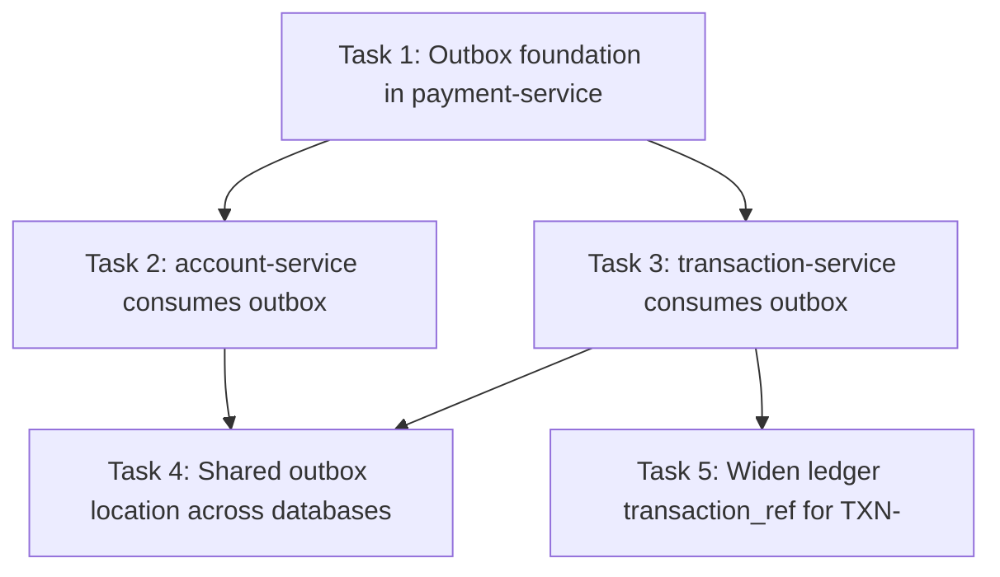

# Implementation Plan: Outbox Balance & History Propagation

## Overview

This plan implements the Transactional Outbox propagation across three Spring Boot services in the RP Digital Bank monorepo (`sg.edu.rp.sandbox.*`, Spring Boot 3.5.x, Spring Data JPA, Flyway, H2 in MySQL mode for tests). Work is split into exactly three incremental, test-driven tasks matching the design's Demos:

- **Task 1** builds the outbox foundation in `payment-service` (opt-in publisher, atomic write, extended payload). Both consumers depend on it.
- **Task 2** makes `account-service` consume the outbox and update balances idempotently.
- **Task 3** makes `transaction-service` consume the outbox and append statement history idempotently.

Each task ends by wiring its component into the running service so there is no orphaned code. Test sub-tasks are marked optional with `*` and use the existing JUnit 5 + Spring Boot Test / `@DataJpaTest` style on H2 MySQL mode (no MySQL needed).

## Tasks

- [x] 1. Outbox foundation in payment-service (opt-in publisher, atomic write)
  - [x] 1.1 Extend `PaymentCompletedEvent` and update in-process references
    - In `common`, add `fromCustomerRef` and `toCustomerRef` fields to the `PaymentCompletedEvent` record (both non-null), keeping `transactionRef`, `fromAccount`, `toAccount`, `amount`, `currency`, `occurredAt` and `eventType()` returning `"PaymentCompleted"`.
    - Update `PaymentService.transfer(...)` to construct the event with `from.getCustomerRef()` and `to.getCustomerRef()` (accounts already loaded), keeping `eventPublisher.publish(...)` inside the existing `@Transactional`.
    - Fix any in-process consumers/handlers and test fixtures that construct `PaymentCompletedEvent` so the module still compiles.
    - _Requirements: 3.1, 3.2, 3.3, 3.4_

  - [x] 1.2 Add the `event_outbox` migration and JPA mapping in payment-service
    - Add Flyway migration `V3__create_event_outbox.sql` with columns `id` (BIGINT AUTO_INCREMENT PK), `event_type` VARCHAR(100) NOT NULL, `transaction_ref` VARCHAR(100) NOT NULL, `payload` LONGTEXT NOT NULL, `occurred_at` TIMESTAMP NOT NULL, `created_at` TIMESTAMP NOT NULL, plus index `idx_event_outbox_type` on `(event_type, id)`.
    - Add the `OutboxEvent` `@Entity` (`@Table(name = "event_outbox")`) mapping those columns exactly (`@Lob String payload`) so `ddl-auto=validate` passes, and an `OutboxRepository extends JpaRepository<OutboxEvent, Long>`.
    - _Requirements: 1.5, 1.6_

  - [x]* 1.3 Write migration + mapping validation test
    - `@DataJpaTest` on H2 MySQL mode with Flyway: migrations apply and entities validate against the schema (`ddl-auto=validate`); a saved `OutboxEvent` round-trips all columns.
    - _Requirements: 1.5, 1.6_

  - [x] 1.4 Implement `OutboxEventPublisher` and wire it via config
    - In `events-adapters`, add `OutboxEventPublisher implements EventPublisher`: inject `OutboxRepository` and the shared `ObjectMapper`, serialize the event to a JSON string, build one `OutboxEvent` (`event_type=event.eventType()`, `transaction_ref=event.transactionRef()`, `occurred_at=event.occurredAt()`, `created_at=now()`), and `save(...)` so it joins the caller's active transaction (no new/`REQUIRES_NEW` transaction).
    - In `EventsAutoConfiguration`, add a `@Bean @ConditionalOnProperty(name="provider.events", havingValue="outbox")` for the outbox publisher; keep the in-process bean with `matchIfMissing=true` so exactly one publisher is active.
    - _Requirements: 1.2, 2.1, 2.2, 2.3, 2.4, 2.5_

  - [x] 1.5 Enable and configure the outbox in payment-service
    - Set `provider.events=outbox` and an `outbox.poll-delay-ms` default in payment-service `application.yml`.
    - Ensure `OutboxEvent`/`OutboxRepository` are component-scanned / entity-scanned and enabled in the payment-service application so the outbox publisher bean wires up at startup.
    - _Requirements: 1.1, 2.1_

  - [x]* 1.6 Write publisher unit test
    - With a stubbed/real `OutboxRepository` and configured `ObjectMapper`, `publish(event)` persists exactly one row with the expected `event_type`, `transaction_ref`, `occurred_at`, and a JSON `payload` that deserializes back to the event.
    - _Requirements: 1.5, 1.6_

  - [x]* 1.7 Write atomicity integration tests
    - `@SpringBootTest` with `provider.events=outbox` on H2 MySQL mode: a successful `transfer(...)` leaves exactly one `event_outbox` row for the `transactionRef`.
    - An AML-blocked / failed transfer (and an injected outbox-insert failure) rolls back the whole transaction, leaving zero `event_outbox` rows and no money movement.
    - **Property 1: Atomicity (producer)** — an outbox row exists iff the transfer committed.
    - _Requirements: 1.1, 1.3, 1.4_

- [x] 2. account-service consumes outbox, updates balances (idempotent)
  - [x] 2.1 Add optimistic locking and balance methods to account-service `Account`
    - Add a `@Version Long version` field (`@Column(name="version", nullable=false)`) and `debit(BigDecimal)` / `credit(BigDecimal)` methods to the account-service `Account` entity.
    - Add Flyway `V3__add_account_version.sql`: `ALTER TABLE accounts ADD COLUMN version BIGINT NOT NULL DEFAULT 0`.
    - _Requirements: 4.7_

  - [x] 2.2 Add `processed_events` migration and mapping in account-service
    - Add Flyway `V4__create_processed_events.sql` (`transaction_ref` VARCHAR(100) PK, `processed_at` TIMESTAMP NOT NULL).
    - Add `ProcessedEvent` `@Entity` (id = `transactionRef`) and `ProcessedEventRepository`.
    - _Requirements: 5.2, 5.4_

  - [x] 2.3 Add read-only outbox access and payload deserialization in account-service
    - Add a read-only `OutboxEvent` view entity + `OutboxRepository` that only `SELECT`s from the shared `event_outbox` (e.g. `findByEventTypeOrderByIdAsc("PaymentCompleted")`), with no insert/update/delete usage.
    - Deserialize `payload` into `PaymentCompletedEvent` via the shared `ObjectMapper`.
    - _Requirements: 4.1, 8.1, 8.6_

  - [x] 2.4 Implement and wire `AccountOutboxPoller`
    - Add `@EnableScheduling` on the account-service application class and an `AccountOutboxPoller @Scheduled(fixedDelayString="${outbox.poll-delay-ms:1000}")`.
    - For each row ordered by `id`: skip if `transactionRef` already in `processed_events`; otherwise, in one local transaction, debit `fromAccount` if present and credit `toAccount` if present (unknown accounts no-op), then insert `processed_events(transactionRef, now())` in that same transaction; a stale `@Version` conflict leaves the balance and the `processed_events` row unwritten so the row retries later.
    - Set the `outbox.poll-delay-ms` default in account-service `application.yml`.
    - _Requirements: 4.2, 4.3, 4.4, 4.5, 4.6, 4.8, 5.1, 5.3, 5.5, 8.3_

  - [x]* 2.5 Write balance + idempotency integration tests
    - `@SpringBootTest` on H2 MySQL mode: seed outbox rows, run `poll()`, assert ACC-1001 −100 and ACC-1002 +100 (net zero across the pair); a second `poll()` leaves balances unchanged.
    - An unknown-account event is marked processed with no error and no balance change.
    - **Property 2: Idempotency** and **Property 3: Conservation**.
    - _Requirements: 4.2, 4.3, 4.4, 5.1, 5.3_

  - [x]* 2.6 Keep existing account-service tests green
    - Run the existing account ownership / endpoint tests (mock `JwtDecoder` + `jwt()` post-processor) and confirm they still pass after the entity and schema changes.
    - _Requirements: 8.3_

- [x] 3. transaction-service consumes outbox, appends statement history (idempotent)
  - [x] 3.1 Add `processed_events` migration and mapping in transaction-service
    - Add Flyway `V3__create_processed_events.sql` (`transaction_ref` VARCHAR(100) PK, `processed_at` TIMESTAMP NOT NULL).
    - Add `ProcessedEvent` `@Entity` (id = `transactionRef`) and `ProcessedEventRepository`.
    - _Requirements: 7.2, 7.5_

  - [x] 3.2 Add read-only outbox access and payload deserialization in transaction-service
    - Add a read-only `OutboxEvent` entity + `OutboxRepository` that only `SELECT`s from the shared `event_outbox` (`findByEventTypeOrderByIdAsc("PaymentCompleted")`), no writes.
    - Deserialize `payload` into `PaymentCompletedEvent` via the shared `ObjectMapper`.
    - _Requirements: 6.1, 8.2, 8.6_

  - [x] 3.3 Implement and wire `TransactionOutboxPoller`
    - Add `@EnableScheduling` on the transaction-service application class and a `TransactionOutboxPoller @Scheduled(fixedDelayString="${outbox.poll-delay-ms:1000}")`.
    - For each row ordered by `id`: skip if `transactionRef` already in `processed_events`; otherwise, in one local transaction, build a DEBIT leg (source: `accountNumber=fromAccount`, `customerRef=fromCustomerRef`, `counterparty=toAccount`) and a CREDIT leg (destination: `accountNumber=toAccount`, `customerRef=toCustomerRef`, `counterparty=fromAccount`), each with `transactionRef`, `description`, `amount`, `currency`, and `bookedAt=occurredAt`; call the existing `TransactionService.record(...)` with both legs and insert `processed_events(transactionRef, now())` in the same transaction.
    - Set the `outbox.poll-delay-ms` default in transaction-service `application.yml`.
    - _Requirements: 6.2, 6.3, 6.4, 6.5, 6.6, 6.7, 6.8, 7.1, 7.2, 8.4_

  - [x]* 3.4 Write history + idempotency integration tests
    - `@SpringBootTest` on H2 MySQL mode: after a completed-transfer outbox row, `poll()` appends exactly two legs; a redelivery `poll()` appends none; `history(...)` returns legs ordered `bookedAt` desc then `id` desc.
    - **Property 2: Idempotency** and **Property 4: Payload completeness** (every leg has non-null `customerRef`).
    - _Requirements: 7.1, 7.3, 7.4_

  - [x]* 3.5 Keep existing transaction-service tests green
    - Run the existing history / ledger tests and confirm they still pass after the schema and poller changes.
    - _Requirements: 8.4_

- [x] 4. Shared outbox location across databases (Option A: consumers read sandbox_payment.event_outbox)
  - [x] 4.1 Introduce a configurable outbox schema in both consumers
    - Add an `outbox.schema` property (default `sandbox_payment`) to account-service and transaction-service `application.yml`.
    - Make the read-only `OutboxEvent` entity resolve its table schema from this property (e.g. a Hibernate physical-naming/schema strategy, an `@Table(schema=...)` driven by config, or an entity-manager default-schema approach) so the consumer SELECTs `sandbox_payment.event_outbox` in prod/compose and the local test DB in H2.
    - _Requirements: 9.2, 9.3, 9.4, 9.5_

  - [x] 4.2 Remove the per-consumer event_outbox copy migrations
    - Delete account-service `V5__create_event_outbox_readonly.sql` and transaction-service `V4__create_event_outbox_readonly.sql`.
    - Ensure `ddl-auto=validate` no longer expects a local `event_outbox` in the consumer schema (the shared outbox is not part of the consumer's own Flyway-managed schema); keep `OutboxEvent` `@Immutable` and read-only.
    - _Requirements: 9.2, 9.6, 8.1, 8.2_

  - [x] 4.3 Point the consumers at the shared outbox in docker-compose and verify end-to-end
    - Ensure account-service and transaction-service have the grants/config to read `sandbox_payment.event_outbox` on the shared MySQL (root already has SELECT); set `OUTBOX_SCHEMA`/`outbox.schema=sandbox_payment` env as needed in docker-compose.yml; confirm payment-service keeps `provider.events=outbox`.
    - Document the `docker compose up --build` end-to-end check: transfer ACC-1001 -> ACC-1002, then observe account balances and transaction history update within the poll delay.
    - _Requirements: 9.1, 9.2_

  - [x]* 4.4 Update consumer poller tests for the configurable schema
    - Set `outbox.schema` to the H2 test database in the account-service and transaction-service poller tests; seed `event_outbox` in that DB; assert propagation and idempotency still hold. Add a guard that no local `event_outbox` Flyway migration exists in either consumer.
    - _Requirements: 9.6, 4.2, 4.3, 6.2, 7.3_

  - [x]* 4.5 Full build + regression
    - Run `./mvnw -B -ntp verify` (H2, no MySQL) and confirm the whole monorepo is green after the schema/config change.
    - _Requirements: 9.2_

- [x] 5. Fix ledger transaction_ref column width for real transfer references (TXN-<uuid>)
  - Found during `docker compose` end-to-end testing against real MySQL: transaction-service fails to append ledger legs with `Data truncation: Data too long for column 'transaction_ref' at row 1` (SQL 1406 / 22001), repeating every poll. Root cause: transaction-service's pre-existing `V1__create_ledger.sql` defines `ledger_entries.transaction_ref VARCHAR(36)`, but a real transfer reference is `TXN-<uuid>` = 40 characters, so the insert is rejected. The poller correctly catches the error and never marks the event processed, so it retries forever. Consequence: account balances DID propagate (account-service applied the debit/credit) but statement history stayed empty. H2 tests missed this because they used short `transactionRef`s like `TXN-TEST-1` that fit in `VARCHAR(36)`. Column audit across schemas: `sandbox_payment.event_outbox.transaction_ref`=VARCHAR(100), `sandbox_payment.ledger_entries`=VARCHAR(50), `sandbox_account.processed_events`=VARCHAR(100), `sandbox_transaction.processed_events`=VARCHAR(100), `sandbox_transaction.ledger_entries.transaction_ref`=VARCHAR(36) <-- the only too-narrow column. Fix widens it to VARCHAR(50) (consistent with payment-service's ledger, comfortably fits `TXN-`+36-char UUID = 40 chars). Depends on Task 3.
  - [x] 5.1 Add transaction-service migration `V4__widen_ledger_transaction_ref.sql`: `ALTER TABLE ledger_entries MODIFY transaction_ref VARCHAR(50) NOT NULL;` (V4 is free; the old V4 `event_outbox` copy migration was deleted in Task 4). Update the transaction-service `LedgerEntry` entity's `transaction_ref` `@Column(length=...)` if it is constrained (add/adjust `@Column(length=50)` on `transaction_ref` if present) so `ddl-auto=validate` passes.
    - _Requirements: 6.2, 6.5_

  - [x]* 5.2 Add/extend a poller test using a realistic 40-char `TXN-<uuid>` transactionRef (e.g. `TXN-` + a random UUID) asserting both ledger legs persist and `history(...)` returns them; guards against the `VARCHAR(36)` regression (the prior poller test used a short ref).
    - _Requirements: 6.2, 7.3_

  - [x]* 5.3 Full build (`./mvnw -B -ntp verify`, H2) green.
    - _Requirements: 6.2_

## Notes

- Tasks marked with `*` are optional (tests) and can be skipped for a faster MVP; core implementation sub-tasks are never optional.
- Each sub-task references specific requirement clauses for traceability.
- Property tests/assertions map to the design's Correctness Properties (Property 1 atomicity, Property 2 idempotency, Property 3 conservation, Property 4 payload completeness, Property 5 isolation via read-only outbox access).
- `payload` is stored as portable TEXT/`LONGTEXT` JSON (not native JSON) so H2 MySQL mode + Flyway + `ddl-auto=validate` behave identically to MySQL 8.
- Both consumers depend on Task 1 for the shared `event_outbox` table and the extended `PaymentCompletedEvent` payload (customer refs).

## Verification

After all tasks, the entire monorepo MUST build green on H2 with no MySQL required:

```
./mvnw -B -ntp verify
```

All unit, slice (`@DataJpaTest`), and `@SpringBootTest` suites run on H2 in MySQL mode via Flyway and `ddl-auto=validate`.

## Task Dependency Graph



Per-task dependencies:

- **Task 1** — no dependencies (foundation: extended `PaymentCompletedEvent`, `event_outbox` table, `OutboxEventPublisher`).
- **Task 2** — depends on **Task 1** (reads the shared `event_outbox` rows and consumes the extended payload).
- **Task 3** — depends on **Task 1** (reads the shared `event_outbox` rows and the extended payload's customer refs). Independent of Task 2.
- **Task 4** — depends on **Task 2** and **Task 3** (retargets both consumers' read-only `OutboxEvent`/pollers at the shared `sandbox_payment.event_outbox` via the configurable `outbox.schema` and removes their local copy migrations).
- **Task 5** — depends on **Task 3** (widens transaction-service `ledger_entries.transaction_ref` from VARCHAR(36) to VARCHAR(50) via new migration `V4__widen_ledger_transaction_ref.sql` so real `TXN-<uuid>` 40-char references persist; fixes the SQL 1406/22001 truncation found in real-MySQL end-to-end testing). Independent of Task 4.

### Leaf-task execution waves

```json
{
  "waves": [
    { "id": 0, "tasks": ["1.1", "1.2"] },
    { "id": 1, "tasks": ["1.3", "1.4"] },
    { "id": 2, "tasks": ["1.5"] },
    { "id": 3, "tasks": ["1.6", "1.7"] },
    { "id": 4, "tasks": ["2.1", "2.2", "3.1"] },
    { "id": 5, "tasks": ["2.3", "3.2"] },
    { "id": 6, "tasks": ["2.4", "3.3"] },
    { "id": 7, "tasks": ["2.5", "2.6", "3.4", "3.5"] },
    { "id": 8, "tasks": ["4.1", "4.2", "5.1"] },
    { "id": 9, "tasks": ["4.3", "5.2"] },
    { "id": 10, "tasks": ["4.4", "5.3"] },
    { "id": 11, "tasks": ["4.5"] }
  ]
}
```
